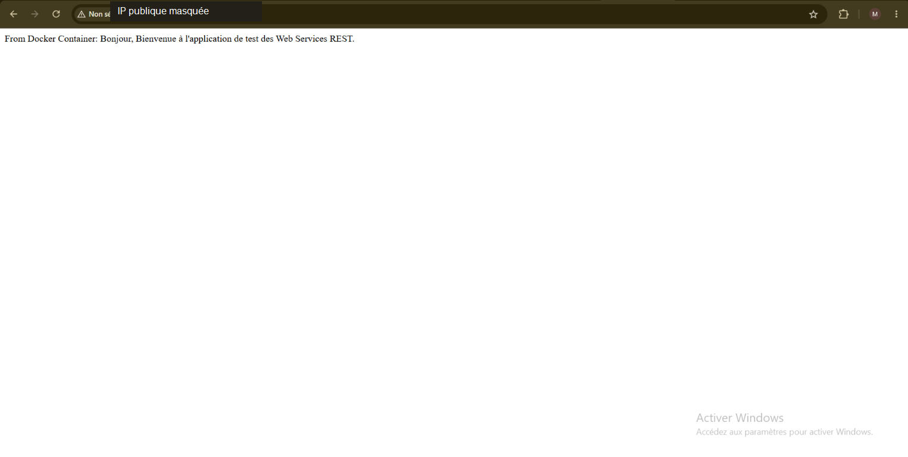

# MPAWI2-G1-event

Application REST de gestion d’événements, développée avec Spring Boot et Java. Le dépôt contient aussi un pipeline Jenkins, un Dockerfile et une configuration Terraform destinée à créer un cluster Amazon EKS.

> **À vérifier avant le déploiement Kubernetes :** l’application de ce dépôt écoute sur le port `8089`, tandis que les manifestes Kubernetes actuellement récupérés depuis le dépôt GitLab `ThourayaLouati/docker-spring-boot` ciblent l’image `thourayalouati/docker-spring-boot:latest` et le port `8083`. Il s’agit d’une application/configuration distincte. Adaptez les manifestes et l’image au projet `eventsProject` avant de présenter le pipeline comme déployant cette application.

## Sommaire

- [Technologies](#technologies)
- [Fonctionnalités et API](#fonctionnalités-et-api)
- [Prérequis](#prérequis)
- [Lancer l’application](#lancer-lapplication)
- [Compiler et tester](#compiler-et-tester)
- [Créer une image Docker](#créer-une-image-docker)
- [Pipeline Jenkins](#pipeline-jenkins)
- [Infrastructure AWS avec Terraform](#infrastructure-aws-avec-terraform)
- [Déploiement Kubernetes](#déploiement-kubernetes)
- [Résultat observé](#résultat-observé)
- [Structure du dépôt](#structure-du-dépôt)

## Technologies

- Java 21
- Node.js 24 et npm, pour l’interface Angular
- Spring Boot 2.7.18
- Maven (Maven Wrapper inclus)
- Spring Web et Spring Data JPA
- Springdoc OpenAPI / Swagger UI
- Lombok
- JUnit / Spring Boot Test
- JaCoCo pour le rapport de couverture
- Docker
- Jenkins
- Terraform, AWS et Amazon EKS
- Kubernetes (`kubectl`)

## Fonctionnalités et API

Le contrôleur REST principal est préfixé par `/events/event`. Les routes définies dans `EventRestController` sont :

| Méthode | Route | Description |
| --- | --- | --- |
| `POST` | `/events/event/addPart` | Ajouter un participant à partir d’un corps JSON |
| `POST` | `/events/event/addEvent` | Ajouter un événement |
| `POST` | `/events/event/addEvent/{id}` | Ajouter un événement et l’associer au participant indiqué |
| `PUT` | `/events/event/addAffectLog/{description}` | Ajouter et associer une logistique à un événement |
| `GET` | `/events/event/getLogs/{d1}/{d2}` | Rechercher les logistiques entre deux dates (`yyyy-MM-dd`) |
| `GET` | `/events/logistics` | Lister les logistiques |
| `GET` | `/events/logistics/{id}` | Lire une logistique |
| `POST` | `/events/logistics` | Créer une logistique |
| `PUT` | `/events/logistics/{id}` | Modifier une logistique |
| `DELETE` | `/events/logistics/{id}` | Supprimer une logistique |

Le serveur utilise le port `8089` et le context path `/events`, selon `src/main/resources/application.properties`.

### Interface Angular

L’interface Angular se trouve dans `frontend/`. Elle propose un tableau de bord CRUD pour les logistiques et transmet ses appels API à Spring Boot avec un proxy de développement.

Dans un premier terminal, démarrez Spring Boot avec H2 comme indiqué ci-dessus. Dans un second terminal :

```powershell
cd frontend
npm start
```

Ouvrez `http://localhost:4200`. Pour compiler l’interface :

```powershell
npm run build
```

### Tester l’API avec Swagger

Lancer l’application, puis ouvrir Swagger UI à `http://localhost:8089/events/swagger-ui.html`. La spécification OpenAPI est disponible à `http://localhost:8089/events/v3/api-docs`. Dans Swagger UI, ouvrir un endpoint, cliquer sur **Try it out**, remplir les paramètres ou le JSON, puis cliquer sur **Execute**.

Exemple de corps JSON pour créer une logistique :

```json
{
  "description": "Projecteur",
  "reserve": true,
  "prixUnit": 100.0,
  "quantite": 2
}
```

Le CRUD ajouté concerne les logistiques. La base configurée dans `application.properties` doit être joignable pour que les opérations persistantes fonctionnent.

## Prérequis

- JDK 21
- Git
- Docker, si vous souhaitez construire/exécuter l’image
- Jenkins avec les outils/greffons correspondants, pour le pipeline
- Un compte AWS et les permissions adaptées, uniquement pour Terraform/EKS
- `kubectl` configuré, pour interagir avec un cluster Kubernetes

## Lancer l’application

Depuis la racine du dépôt, sous Windows :

```powershell
.\mvnw.cmd spring-boot:run
```

Sous Linux/macOS :

```bash
./mvnw spring-boot:run
```

L’application est ensuite disponible à `http://localhost:8089/events`.

### Base de données

La configuration actuelle dans `application.properties` pointe vers MySQL sur `localhost:3306`, avec la base `eventsProject`. Le `pom.xml` inclut H2, mais le connecteur MySQL est commenté. Il faut donc harmoniser la configuration et les dépendances avant un lancement local avec MySQL (ou configurer explicitement H2). Ne mettez pas de mot de passe réel dans Git : utilisez des variables d’environnement ou un gestionnaire de secrets.

Pour lancer localement avec la base H2 en mémoire fournie par le profil `h2`, utilisez :

```powershell
.\mvnw.cmd spring-boot:run "-Dspring-boot.run.profiles=h2"
```

Cette base temporaire est pratique pour essayer Swagger et les routes CRUD; ses données sont perdues à l’arrêt de l’application.

## Compiler et tester

Compilation et tests avec Maven Wrapper :

```powershell
.\mvnw.cmd clean test
```

Pour produire le JAR :

```powershell
.\mvnw.cmd clean package
```

Sous Linux/macOS, remplacez `.\mvnw.cmd` par `./mvnw`.

Le JAR est généré dans `target/`. Le rapport JaCoCo est configuré sous `target/site/jacoco/`; les résultats des tests sont disponibles sous `target/surefire-reports/`.

## Créer une image Docker

Le Dockerfile utilise le JRE Eclipse Temurin 21, copie le JAR construit depuis `target/`, et expose le port `8089`.

```bash
docker build -t eventsproject:local .
docker run --rm -p 8089:8089 eventsproject:local
```

L’application a besoin d’une base de données accessible selon sa configuration. Le conteneur ne fournit pas lui-même MySQL.

## Pipeline Jenkins

Le `Jenkinsfile` décrit les étapes suivantes :

1. Récupération de la branche `Hayet-Medini` de ce dépôt GitHub.
2. Nettoyage, compilation et tests Maven.
3. Analyse SonarQube et publication Maven vers Nexus.
4. Construction de l’image Docker et publication dans Docker Hub.
5. Vérification des identifiants AWS.
6. Initialisation, validation et planification Terraform.
7. Mise à jour du kubeconfig et application des manifestes Kubernetes.

### Déclencher Jenkins avec un webhook GitHub

Le `Jenkinsfile` utilise le déclencheur `githubPush()` : un événement `push` GitHub peut ainsi lancer le pipeline sans polling. Pour l’activer :

1. Installer le plugin **GitHub** dans Jenkins, puis enregistrer le `Jenkinsfile` dans la branche `Hayet-Medini`.
2. Créer/configurer un job **Pipeline** qui récupère ce dépôt et cette branche depuis SCM. Exécuter le job une première fois pour que Jenkins charge le déclencheur du `Jenkinsfile`.
3. Dans les paramètres du dépôt GitHub, ouvrir **Settings → Webhooks → Add webhook**.
4. Saisir l’URL Jenkins suivie de `/github-webhook/` (par exemple `https://jenkins.example.com/github-webhook/`), choisir `application/json`, puis sélectionner **Just the push event** et enregistrer.
5. Vérifier la livraison dans la section **Recent Deliveries** du webhook GitHub et consulter la console du job Jenkins.

GitHub doit pouvoir joindre cette URL. Pour un Jenkins local, il faut une URL accessible depuis Internet via une configuration réseau sécurisée; `localhost` ne fonctionnera pas. Protégez Jenkins et son accès réseau avant d’exposer le point de terminaison. Le déclenchement du pipeline lance ses étapes existantes, y compris celles liées à AWS et au déploiement.

### Envoyer la sortie console par e-mail

Le bloc `post` du `Jenkinsfile` envoie le journal console complet en pièce jointe après chaque build, qu’il réussisse ou échoue. Il nécessite le plugin **Email Extension** (`email-ext`) et une configuration SMTP valide dans **Manage Jenkins → System → Extended E-mail Notification**. Configurez les paramètres SMTP et les identifiants dans Jenkins, jamais dans le dépôt, puis utilisez **Test configuration** pour vérifier l’envoi.

Définissez également `BUILD_EMAIL_RECIPIENT` comme variable d’environnement globale dans **Manage Jenkins → System → Global properties → Environment variables** avec l’adresse du destinataire souhaité. Cette valeur n’est volontairement pas inscrite dans le `Jenkinsfile`, car le dépôt est public. Sans plugin, configuration SMTP ou destinataire, l’étape de notification échouera explicitement.

### Identifiants Jenkins attendus

Les credentials sont à créer dans Jenkins; les valeurs secrètes ne doivent pas être inscrites dans le dépôt.

| ID Jenkins | Type utilisé |
| --- | --- |
| `sonar-token` | Secret text |
| `dockerhub-credentials` | Nom d’utilisateur et mot de passe/token |
| `aws-credentials` | Fichier de credentials AWS |

Le Jenkinsfile utilise également des chemins d’outils propres à l’agent Windows (JDK, Maven, Terraform et AWS CLI). Ils doivent correspondre à la machine qui exécute le pipeline. L’étape de déploiement requiert aussi `kubectl` dans le `PATH`.

`APPLY_TERRAFORM` est désactivé par défaut. Ne l’activez pas sans examiner le plan Terraform, confirmer le compte/région AWS et vérifier l’état Terraform utilisé par Jenkins. Le pipeline n’a pas de backend Terraform distant configuré ici; l’état local de Jenkins n’est pas automatiquement celui de votre poste.

## Infrastructure AWS avec Terraform

Le dossier `terraform/` contient la configuration qui :

- sélectionne la région `us-east-1` et le VPC par défaut;
- récupère des sous-réseaux dans les zones configurées;
- utilise le rôle IAM `LabRole`;
- crée des groupes de sécurité, un cluster EKS `mykubernetes` et un groupe de nœuds de deux instances souhaitées.

Commandes à exécuter depuis `terraform/` :

```bash
terraform init
terraform fmt -check
terraform validate
terraform plan
```

N’exécutez `terraform apply` qu’après avoir contrôlé le plan et obtenu l’autorisation requise. Les ressources EKS et EC2 peuvent entraîner des frais. La configuration des groupes de sécurité inclut actuellement des règles entrantes sur les ports `8083` et `30000` depuis `0.0.0.0/0`; cette exposition est large et doit être restreinte selon les exigences du cours avant un usage réel.

Ne publiez jamais `terraform.tfstate`, `terraform.tfstate.backup`, les credentials AWS ou le dossier `.terraform/`. L’état Terraform peut contenir des informations sensibles.

## Déploiement Kubernetes

Une fois un cluster existant et accessible, les commandes de vérification usuelles sont :

```bash
aws eks update-kubeconfig --name mykubernetes --region us-east-1
kubectl get nodes
kubectl get pods
kubectl get services
```

Le service des manifestes observés est de type `NodePort`, sur le port `30000`, avec un port cible `8083`. Pour le projet `eventsProject`, il faut d’abord adapter les manifestes à l’image publiée par le pipeline et au port réel `8089`. L’accès depuis Internet dépend aussi des règles réseau appliquées aux nœuds. N’exposez pas un port à tout Internet sans nécessité.

## Résultat observé

Les sorties ci-dessous documentent un déploiement de démonstration. Les adresses publiques des nœuds ont été masquées, car elles sont temporaires.

### Services

```text
NAME                  TYPE        CLUSTER-IP     EXTERNAL-IP   PORT(S)
kubernetes            ClusterIP   10.100.0.1     <none>        443/TCP
spring-boot-service   NodePort    10.100.21.31   <none>        8083:30000/TCP
```

### Pods

```text
NAME                                  READY   STATUS    RESTARTS
my-spring-boot-app-5554566ccf-qsfrc   1/1     Running   0
my-spring-boot-app-5554566ccf-vnqnh   1/1     Running   0
```

### Nœuds

```text
NAME                            STATUS   ROLES    INTERNAL-IP     EXTERNAL-IP
ip-172-31-28-85.ec2.internal    Ready    <none>   172.31.28.85   [masquée]
ip-172-31-70-240.ec2.internal   Ready    <none>   172.31.70.240  [masquée]
```



## Structure du dépôt

```text
.
├── src/
│   ├── main/java/tn/esprit/eventsproject/  # Application, API, entités, dépôts et services
│   ├── main/resources/                     # Configuration Spring
│   └── test/java/                          # Tests unitaires et d’intégration
├── terraform/                              # Infrastructure AWS/EKS
├── docs/images/                            # Captures de démonstration
├── Dockerfile
├── Jenkinsfile
├── pom.xml
├── mvnw
└── mvnw.cmd
```
